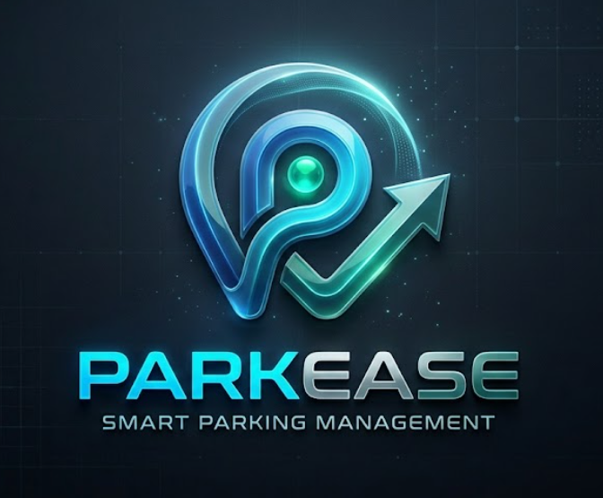
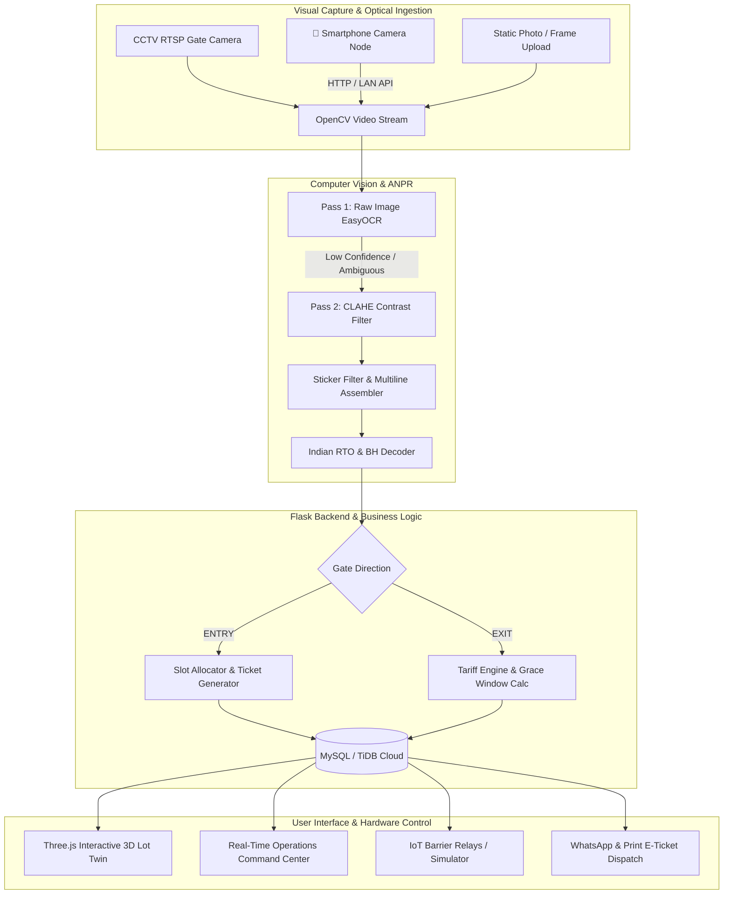

<div align="center">



# ParkEase — Smart Parking Operations & ANPR Command Center

**Enterprise-grade parking facility automation, real-time 3D lot digital twin, dual-pass optical number plate recognition (ANPR), and wireless mobile scanning.**

[](https://www.python.org/)
[](https://flask.palletsprojects.com/)
[](https://threejs.org/)
[](https://github.com/JaidedAI/EasyOCR)
[](https://tidbcloud.com/)
[](https://www.docker.com/)
[-10B981?style=flat&logo=pytest&logoColor=white)](#automated-testing)
[](LICENSE)

</div>

---

## 📌 Executive Overview

**ParkEase** is a production-grade, real-time parking operations management platform engineered for multi-level parking structures, commercial complexes, and municipal transit hubs. 

It combines **computer-vision license plate recognition (ANPR)** with a **spatial Three.js 3D digital twin** and **IoT hardware telemetry**, providing operators with total visibility and automation across entry gates, bay allocation, reservations, cashier shift reconciliation, and digital ticket issuance.

---

## 🚀 Key Features

### 🗺️ Real-Time 3D Lot Digital Twin
* **Interactive WebGL Rendering:** Live Three.js visualization of all ground, outdoor, and basement bays.
* **Camera Preset Modes:** One-tap toggling between Isometric 3D View, Overhead Top-Down Layout, and Entry Gate Perspective.
* **Live Slot Telemetry:** Instant visual color coding for Standard Available (`🟢`), Occupied (`🔴`), Maintenance (`🟡`), EV Fast-Charging (`⚡`), VIP Reserved (`👑`), and Accessible/Priority (`♿`) bays.
* **Raycaster Bay Inspection:** Click any 3D parking bay to view parked vehicle registration, active session duration, and issue one-click gate exit clearances.

### 📷 Dual-Pass OpenCV & EasyOCR ANPR Gate Monitor
* **Contrast-Enhanced Recognition:** High-speed optical plate recognition combining original color frames with adaptive **CLAHE** (Contrast Limited Adaptive Histogram Equalization) preprocessing.
* **🇮🇳 Complete Indian MoRTH & Bharat (BH) Series Decoder:**
  * Auto-identifies State/Union Territory jurisdiction (e.g. `UP`, `DL`, `MH`, `KA`, `TN`, `HR`).
  * Resolves regional transport registering offices (e.g. `Janakpuri RTO`, `Ghaziabad RTO`).
  * Recognizes Pan-India Bharat Series (`22BH1234AA`) and electric green plates (`MH02EV1000`).
* **Intelligent Noise Rejection:** Heuristic filtering automatically ignores vehicle bumper decals and fuel stickers (`CNG`, `LPG`, `PETROL`, `DIESEL`, manufacturer badges) to ensure only valid registration numbers are captured.
* **Human-in-the-Loop Review Queue:** Automatic routing of scans with confidence below 85% to an operator review interface for instant validation or correction.

### 📱 Wireless Mobile Camera Scanner Node (`/mobile-scanner`)
* **Zero-Install Smartphone Node:** Turn any smartphone into a remote wireless ANPR optical scanner by scanning an on-screen QR code.
* **Live Viewfinder HUD:** Real-time camera stream with cyber HUD reticle, animated laser sweep, and audio chimes (synthesized via Web Audio API).
* **Native Camera Fallback:** 100% device compatibility across iOS Safari and Android Chrome with instant photo capture fallbacks (`capture="environment"`).
* **Real-Time Station Polling:** Scans taken on mobile devices appear on the desktop operator terminal in under a second with audio confirmation and pre-filled gate forms.

### 🏷️ Dynamic Pricing Engine & Grace Periods
* **Flexible Tariff Configuration:** Customizable hourly rates, minimum base charges, and billing increments (e.g., 60-minute units).
* **Free Grace Period:** Configurable free exit window (e.g., 15 minutes) for quick drop-offs and pick-ups.
* **Metered EV Supercharging:** Integrated kilowatt-hour (`₹/kWh`) tariff calculation added directly to final exit tickets.
* **Lost Ticket Resolution:** Operator dispute flow with audited flat lost ticket penalties and automated barrier release.

### 🧾 Cashier Shift Settlement & Digital Receipts
* **Shift Handover Audit:** Live reconciliation calculating total collected cash, UPI/digital transactions, and traffic volume.
* **Interactive Cash Drawer Audit:** Real-time variance calculator identifying cash over/short discrepancies.
* **Paperless WhatsApp & SMS Dispatch:** One-click customer e-ticket sharing via WhatsApp API and printable thermal receipts.
* **Data Portability:** Instant CSV exports for parking sessions, payment transactions, and administrative audit trails.

### 🛡️ Enterprise Security & Access Control
* **Role-Based Access Control (RBAC):** Granular segregation between `administrator` (full facility configuration, user provisioning, rate overrides) and `operator` (toll gate check-in, ticket printing).
* **Defense in Depth:** Cryptographic password hashing via PBKDF2-HMAC-SHA256, CSRF tokens on all state-modifying requests, sliding-window rate limiting on authentication routes, and strict HTTP security headers.

---

## 🏛️ System Architecture



---

## 💻 Tech Stack

| Layer | Technologies |
|---|---|
| **Backend & Application** | Python 3.13, Flask 3.1, SQLAlchemy 2.0, Werkzeug, PyMySQL |
| **Computer Vision & AI** | OpenCV (`opencv-python-headless`), EasyOCR, PyTorch (`torch`, `torchvision`) |
| **3D Graphics & Visuals** | Three.js (r166), OrbitControls, Canvas2D Texture Synthesis, Web Audio API |
| **Styling & Design System** | Cyber-Glassmorphism CSS3, Inter & JetBrains Mono Fonts, Aurora Canvas Shaders |
| **Database** | MySQL 8.0, TiDB Cloud Serverless (Distributed Cloud MySQL) |
| **DevOps & Production** | Docker, Gunicorn, Waitress WSGI, Render.com |
| **Testing & Quality** | Pytest, TestClient, Automated Contract & Security Assertions |

---

## 🏁 Getting Started

### Prerequisites
* **Python 3.11+** (Python 3.13 recommended)
* **MySQL 8.0+** or a free [**TiDB Cloud Serverless**](https://tidbcloud.com/) MySQL instance.

### 1. Clone the Repository
```bash
git clone https://github.com/abhisheksinghsengar9452-create/parkease.git
cd parkease
```

### 2. Set Up Virtual Environment
```bash
# Windows (PowerShell)
py -m venv .venv
.\.venv\Scripts\Activate.ps1

# Linux / macOS
python3 -m venv .venv
source .venv/bin/activate
```

### 3. Install Dependencies
```bash
pip install --upgrade pip
pip install -r requirements.txt
```

### 4. Configure Environment Variables
Create a `.env` file in the project root:
```env
# Database connection string (MySQL or TiDB Cloud)
DATABASE_URL=mysql+pymysql://<user>:<password>@<host>:4000/<database>?ssl_verify_cert=true

# Flask configuration
SECRET_KEY=generate-a-strong-random-key-here
FLASK_ENV=development
PORT=5000
HOST=0.0.0.0
```

### 5. Provision Administrator Account
Run the CLI provisioning command:
```bash
flask create-admin --email admin@parkease.local --name "Master Administrator"
# Enter a secure password (min 12 characters) when prompted
```

### 6. Start Development Server
```bash
python app.py
```
Open **`http://127.0.0.1:5000`** in your browser.

---

## 🧪 Automated Testing

ParkEase includes a comprehensive automated test suite verifying database contracts, OCR recognition pipelines, pricing grace periods, EV charging, security headers, and mobile scanner synchronization:

```bash
pytest
```

Output:
```text
tests/test_advanced_features.py ....                                     [ 16%]
tests/test_dashboard_contract.py .                                       [ 20%]
tests/test_database_contract.py .                                        [ 25%]
tests/test_devices.py ..                                                 [ 33%]
tests/test_exit_workflow_contract.py .                                   [ 37%]
tests/test_mobile_scanner.py ....                                        [ 54%]
tests/test_parking_contract.py ..                                        [ 62%]
tests/test_payments.py ..                                                [ 70%]
tests/test_recognition.py ..                                             [ 79%]
tests/test_security.py ..                                                [ 87%]
tests/test_services.py ...                                               [100%]

======================== 24 passed in 9.25s ========================
```

---

## 🐳 Docker Deployment

To build and run ParkEase inside an isolated container:

```bash
# Build the container image
docker build -t parkease .

# Run container binding to port 5000
docker run -d -p 5000:5000 --env-file .env --name parkease-app parkease
```

---

## ☁️ Production Deployment on Render

ParkEase includes a native [`render.yaml`](render.yaml) configuration ready for zero-downtime deployment:

1. Push your repository to GitHub.
2. Link your repository in [**Render Dashboard**](https://dashboard.render.com/).
3. Add the following **Environment Variables** in Render:
   * `DATABASE_URL`: `mysql+pymysql://<user>:<password>@<tidb-host>:4000/<db>?ssl_verify_cert=true`
   * `SECRET_KEY`: `<secure-random-32-byte-key>`
   * `FLASK_ENV`: `production`
   * `PYTHON_VERSION`: `3.13.0`
4. The service will build via Docker, automatically initialize tables, and launch behind Gunicorn/Waitress.

---

## 📡 REST API Reference

| Endpoint | Method | Role | Description |
|---|---|---|---|
| `/api/dashboard/state` | `GET` | Operator | Live telemetry stream of metrics, 3D bays, active sessions, and devices. |
| `/api/anpr/instant-entry` | `POST` | Operator | One-click ANPR check-in, bay allocation, and barrier release. |
| `/api/anpr/mobile-scan` | `POST` | Node / Phone | Uploads a smartphone camera capture for remote OCR processing. |
| `/api/anpr/latest-mobile-scan` | `GET` | Operator | Long-polling endpoint for station desktop sync. |
| `/api/recognition/images` | `POST` | Operator | Runs dual-pass OCR on uploaded file and returns plate + bounding box. |
| `/api/devices/barrier/operate` | `POST` | Operator | Triggers IoT gate open/close relay hardware simulation. |
| `/api/demo/seed-traffic` | `POST` | Operator | Dispatches simulated traffic vehicles to demonstrate dynamic occupancy. |
| `/api/export/sessions.csv` | `GET` | Operator | Exports all active and completed parking sessions to CSV. |
| `/api/export/payments.csv` | `GET` | Admin | Exports complete settled payments and transaction ledger to CSV. |
| `/api/health` | `GET` | Public | System health check reporting database and OCR subsystem statuses. |

---

## 📄 License

Distributed under the **MIT License**. See [`LICENSE`](LICENSE) for more information.

---

<div align="center">
  <b>Engineered by Abhishek Singh Sengar</b><br>
  <sub>ParkEase Operations Platform · Automated Smart Parking Systems</sub>
</div>
